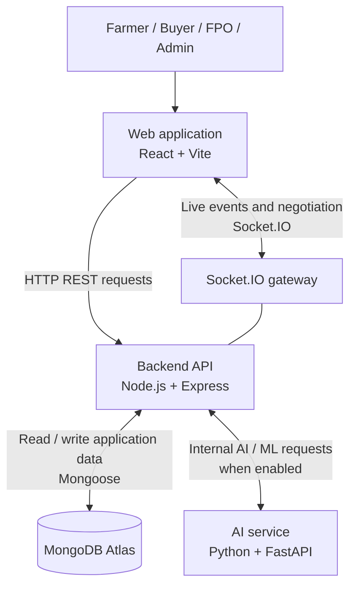

# 🌾 FasalNiti AI (फसलनीति)

**Agricultural decision support for Indian farmers.**

FasalNiti AI brings mandi information, harvest-selling comparisons, buyer connections, and agricultural assistance together in one platform.

> **Better price. Better decisions. Better farming.**
s
[](LICENSE)
[](https://nodejs.org/)
[](https://react.dev/)
[](https://www.mongodb.com/)

**Live demo:** [fasal-niti-for-farmers.vercel.app](https://fasal-niti-for-farmers.vercel.app/)

## The problem

A mandi's listed price does not tell a farmer what they will take home. Transport, storage, produce quality, and buyer offers all affect the final return.

FasalNiti AI is designed to help farmers compare selling options and access relevant agricultural information before making a decision.

## What it offers

- **Harvest decision support** — Compare mandi, storage, and direct-buyer options using estimated costs and returns.
- **Market intelligence** — Explore mandi prices, historical market information, and price forecasts.
- **KisanMitra assistant** — Access agricultural information through text and voice in nine Indian languages.
- **Crop-quality assistance** — Get image-based insights into visible produce-quality indicators.
- **Buyer marketplace** — Create produce listings, receive offers, and negotiate with buyers.
- **Government schemes** — Explore scheme information and profile-based eligibility guidance.
- **Logistics and storage** — Find mandi and warehouse information and compare estimated costs.
- **FPO workflows** — Support produce aggregation and bulk-sale coordination.
- **Admin portal** — Manage users, scheme records, grievances, and platform operations.

*Availability of individual features depends on the current implementation and configuration.*

## Built with

| Layer | Main technologies |
|---|---|
| Frontend | React, Vite, Tailwind CSS |
| Backend | Node.js, Express |
| Database | MongoDB Atlas, Mongoose |
| Real-time communication | Socket.IO |
| AI service | Python, FastAPI |
| Maps and charts | Leaflet, Recharts |
| Authentication | JWT, bcrypt |

## Architecture

The platform uses a React frontend, a Node.js API, MongoDB for persistent data, and a separate Python service for supported AI/ML tasks.



**Request flow**

1. A user interacts with the React application.
2. Standard application requests go to the Express API over HTTP.
3. Live negotiation updates use the Socket.IO connection.
4. The backend reads and writes application data in MongoDB.
5. AI/ML requests are sent to the Python service when that integration is configured.

The browser communicates with the backend; it should not connect directly to MongoDB or call private AI-service endpoints.

## Project structure

```text
FasalNiti-AI/
├── client/       # React frontend
├── server/       # Express API and Socket.IO
├── ai-service/   # Python AI/ML service
├── package.json  # Root-level scripts
└── README.md
```

## Run locally

### Prerequisites

- Node.js 18+
- npm 9+
- MongoDB Atlas connection string
- Python 3.10+ (only if running the AI service)

### 1. Install dependencies

From the project root:

```bash
npm run install-all
```

### 2. Configure environment variables

Create `server/.env` and configure the values required by the backend.

Use the root [`.env.example`](.env.example) as the source of truth. At minimum, the backend needs a MongoDB connection string and a strong JWT secret.

```env
MONGO_URI=your_mongodb_connection_string
JWT_SECRET=replace_with_a_long_random_secret
```

Add optional AI and file-storage credentials only when the corresponding integrations are enabled. Never commit `.env` files, API keys, or real credentials.

### 3. Seed reference data

If your local setup requires initial reference data, run the configured seed command from the project root:

```bash
npm run seed
```

Review the seed script and confirm the database target before running it against any shared or production database.

### 4. Start the application

```bash
npm run dev
```

The documented local addresses are:

- Frontend: `http://localhost:5173`
- Backend: `http://localhost:5001`
- Health check: `http://localhost:5001/api/health`

### Optional: Start the AI service

```bash
cd ai-service
python -m venv venv
```

Activate the virtual environment:

```bash
# Windows
venv\Scripts\activate

# macOS / Linux
source venv/bin/activate
```

Then install dependencies and start the service:

```bash
pip install -r requirements.txt
python main.py
```

Check `main.py` for the service's configured host and port.

## API overview

The backend API is organized around these areas:

| Base path | Purpose |
|---|---|
| `/api/auth` | Registration, login, and profiles |
| `/api/decision` | Harvest decision evaluation |
| `/api/markets` | Mandi and market information |
| `/api/predictions` | Crop price forecasts |
| `/api/listings` | Produce listings |
| `/api/offers` | Buyer offers |
| `/api/orders` | Orders |
| `/api/schemes` | Government schemes and grievances |
| `/api/ai` | Assistant and crop-quality services |
| `/api/admin` | Administrative operations |

For request bodies, response formats, and access requirements, see the route and controller implementations in `server/`.

## User roles

- **Guest** — Access public information and available tools.
- **Farmer** — Manage a profile, create produce listings, and review offers.
- **Buyer** — Browse listings and submit offers.
- **FPO** — Use produce aggregation workflows.
- **Admin** — Manage authorized platform operations.

Access to protected actions must be enforced by the backend, not only by the frontend.

## Data and AI limitations

FasalNiti AI provides decision-support information. It does not replace official market records, agricultural experts, or government authorities.

- Market data can be delayed, incomplete, or unavailable.
- Price forecasts are estimates, not guaranteed future prices.
- Image-based quality insights are not official grading certificates.
- Scheme eligibility guidance does not guarantee approval or payment.
- Return comparisons depend on the prices, quantities, and cost assumptions supplied.

Where available, display the source and last-updated time alongside market information.

## Security

- Keep secrets and credentials out of source control.
- Do not publish default administrator credentials.
- Validate and authorize requests on the server.
- Enforce role-based access for protected routes.
- Restrict uploads and protect personal information.
- Use HTTPS and production-appropriate configuration when deployed.

## Development

Use the scripts defined in the root, `client`, and `server` `package.json` files. Before submitting changes, run the relevant lint, test, and build checks available in the project and update documentation when behavior or setup changes.

## License

This project is licensed under the [MIT License](LICENSE).
